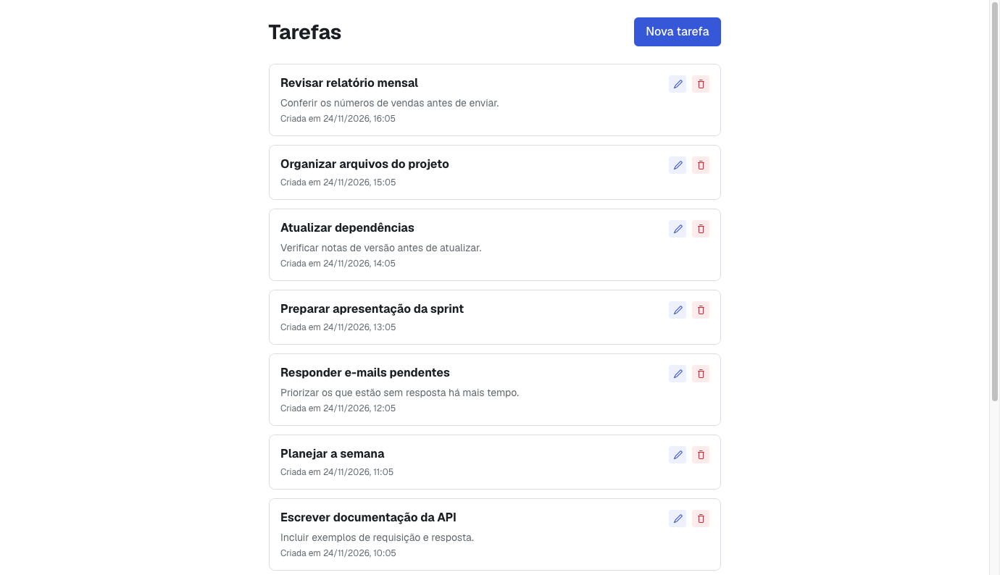

# nextjs-trpc-tasks

Gerenciador de tarefas feito para um case técnico. Dá para listar, criar, editar e excluir tarefas. Os dados ficam em memória, sem banco de dados.



## Decisões

- **Next.js 15, não 16:** o case pede a versão 15.
- **tRPC dentro do Next.js:** frontend e backend no mesmo projeto, com os mesmos tipos dos dois lados.
- **Dados em memória:** o case não pede banco. Só o repositório acessa os dados, então trocar por um banco muda só esse arquivo.
- **Renderização no servidor:** a primeira página de tarefas já vem pronta do servidor, e o navegador não busca os mesmos dados de novo.
- **Criar e editar em um modal:** um único formulário serve para as duas ações, sem sair da lista.
- **Paginação por cursor:** a próxima página começa depois da última tarefa carregada. Assim nenhuma tarefa se repete ou some quando outras são criadas.

## Como rodar

Precisa do Node.js 22.22.2 ou superior (ou 24.15 ou superior).

```bash
npm install
npm run dev
```

Abra [http://localhost:3000](http://localhost:3000). A lista começa com 40 tarefas de exemplo, então dá para ver a rolagem infinita.

Outros comandos:

- `npm run build`: gera a versão de produção
- `npm test`: roda os testes
- `npm run lint`: confere o código

## Stack

Next.js 15, TypeScript, tRPC v11, TanStack Query, Zod, react-hook-form, Radix UI, Tailwind CSS e Vitest.

## Estrutura

```text
src/
  app/          página da lista e rota do tRPC
  components/   componentes da interface
  server/       tRPC, validação e repositório de tarefas
  trpc/         cliente do tRPC e hooks de tarefas
```
